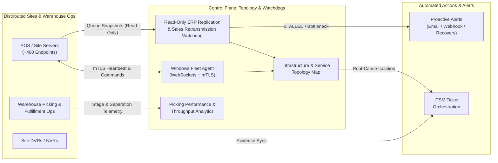
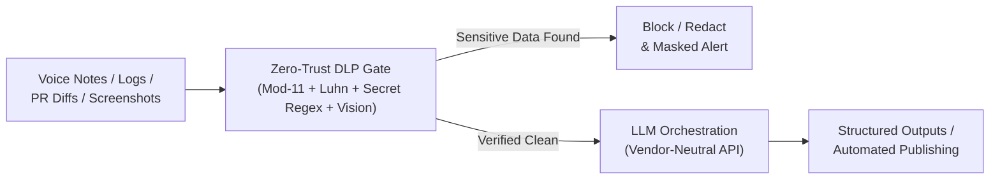

  

# Hi, I'm Gabriel Souza (`@gavicoding`) 👋

**IT Automation, DevOps & Software Engineer | Product Owner (PO), System Implementation & Data Privacy (LGPD/GDPR)**

🌐 **Live Portfolio & Resume:** [gavicoding.github.io](https://gavicoding.github.io) · 💼 **LinkedIn:** [linkedin.com/in/gabrielvsouza](https://www.linkedin.com/in/gabrielvsouza/)

I design and build resilient production tools across **Python, TypeScript, Next.js, T-SQL, and C# (.NET)**, turning repetitive IT operations, Windows Server / Active Directory administration, distributed multi-site and warehouse bottlenecks, web interfaces, and compliance risks into automated, observable, and secure software.

**Education & Credentials:** B.Sc. in Computer Science · Postgraduate specialization in Cybersecurity (UTFPR, ongoing) · Postgraduate in Information Security · MBA in Process Management · Volunteer **Security Committee Member at APDADOS®** (since 2021).

**Security & Privacy:**

---

## 🔧 What I Build

- **Windows Server, Active Directory & Hybrid IT Operations:** Administration of **Windows Server, Active Directory (GPOs, permissions & access control)**, **Level 2 Service Desk**, **remote & chat-based technical support**, Windows fleet services with mutual TLS (mTLS), unattended desktop migrations, and automated sales/sync recovery workflows.
- **Infrastructure Mapping & Observability:** End-to-end service dependency topology maps, read-only database replication monitors, trend-based alerting heuristics, and operational picking/throughput KPIs.
- **Applied AI, DPO Governance & AppSec:** Practical LGPD (Law 13.709/2018) & GDPR DPO programs (RoPA, DPAs, Arts. 7/11/18 workflows, DPIA/RIPD, active **APDADOS® Security Committee** participation), OWASP Top 10 web pentesting (16 critical/medium findings mapped with remediation & hardening plans) + digital forensics, irreversible relational anonymization, time-boxed access governance, and multimodal AI pipelines gated by deterministic & vision-based DLP.
- **Web Engineering & UI Performance:** Next.js App Router dashboards (`TTFB 6.8s -> 0.1s`), interactive Leaflet/OSM location finders, automated WCAG contrast audits, CSP-compliant UI extensions, and responsive animated interfaces.
- **Native Windows Engineering:** MVVM desktop applications in .NET 8 + WPF and standalone PyInstaller utilities built for non-technical end users and IT support teams.
- **Product Ownership (PO) & System Implementation:** End-to-end ERP and internal platform deployments, stakeholder requirements gathering, technical specifications, Kanban backlog governance, UAT sign-off, parallel cutovers, wave rollouts, migration runbooks, software-house coordination, and hands-on user training.

---

## 🚀 Featured Open-Source Projects

| Project | Stack | Description |
| :--- | :--- | :--- |
| **[gavicoding.github.io](https://github.com/gavicoding/gavicoding.github.io)** ([Live Site](https://gavicoding.github.io)) | HTML5 · CSS3 · Vanilla JS · Bilingual | Official bilingual (`EN` / `PT-BR`) portfolio with an interactive CLI, a `Ctrl+K` command palette, three live simulations (DLP redaction, queue health, invoice reconciliation), production case studies told as pain -> solution -> result, and CI checks on every push. Zero frameworks. |
| **[pii-screenshot-guard](https://github.com/gavicoding/pii-screenshot-guard)** ([Docs](https://gavicoding.github.io/pii-screenshot-guard/)) | Python · CLI · GitHub API · OCR/Vision · Docker | Zero-Trust DLP scanner, redactor & GitHub PR diff auditor catching LGPD/GDPR PII (mod-11 CPF/CNPJ, Luhn cards), API secrets, and RFC 1918 internal IPs in logs, PRs, and screenshots. |
| **[queue-health-watchdog](https://github.com/gavicoding/queue-health-watchdog)** | TypeScript · Node.js · Docker | Read-only replication & job queue monitor with snapshot trend heuristics (distinguishing active `HIGH_LOAD` from `STALLED` queues), cooldown alert throttling, webhooks, and a live status dashboard. |
| **[tsql-retail-ops-analytics](https://github.com/gavicoding/tsql-retail-ops-analytics)** | T-SQL · SQL Server · Stored Procs · DBA | Production-inspired T-SQL analytics & DBA toolkit: single-pass conditional sales KPIs, `ROW_NUMBER()` asset deduplication, multi-mode stored procedures, WMS bottlenecks, `sys.dm_tran_locks` diagnostics & least-privilege RBAC. |
| **[infra-ops-playbook](https://github.com/gavicoding/infra-ops-playbook)** | Bash · PowerShell · Docker · Nginx mTLS · systemd | Hybrid infrastructure (Linux + Windows/AD + Docker + Nginx mTLS) operations playbook: signed PowerShell agents, SID-based ACL recovery, Postgres Docker backups, and 24 sanitized troubleshooting cases. |
| **[OtimizaPC](https://github.com/gavicoding/OtimizaPC)** | C# · .NET 8 · WPF (MVVM) | Dark-mode Windows system optimizer with System Restore Points, multi-profile cleanup, content-hash duplicate finder, 90-day orphan residue detection, S.M.A.R.T. health, and instant disk space analysis. |
| **[Thunderbird-Outlook](https://github.com/gavicoding/Thunderbird-Outlook)** | Python · COM · SQLite · vCard 3.0 | Bidirectional Windows email & address-book migrator preserving folder trees, original received dates (`MSGFLAG_UNSENT` / MAPI), senders, attachments, and long file paths (`\\?\`). |

---

## 🗺️ Visual Architecture Highlights (Sanitized)

### Distributed Infrastructure Topology, Fleet Control & ERP Sync Observability

### Applied AI & Zero-Trust DLP Pipeline

---

## 🏗️ Selected Production Architectures (Case Studies)

> Several of these systems run in production and their code is not public. Below are architectural summaries of systems I engineered end-to-end, with names and data left out:

### 1. Infrastructure & Service Dependency Topology Map
- **Challenge:** Multi-site environments often struggle during outages because teams cannot quickly see how sites, departments, hosts, and background services depend on each other.
- **Architecture:** Built a unified **infrastructure & service topology map** linking distributed sites, operational sectors, host nodes, and running services, enabling rapid fault correlation, dependency visualization, and root-cause isolation.

### 2. Automated Sales Retransmission & Sync Recovery
- **Challenge:** Intermittent site connectivity and validation errors caused recurring bottlenecks in sales retransmission between POS/site databases and the central ERP.
- **Architecture:** Engineered an automated detection and **sales retransmission pipeline** that identifies stalled batches, pinpoints failing records early, executes safe recovery/retransmission workflows, and dispatches proactive alerts before manual escalation.

### 3. Warehouse Picking & Operational Performance Analytics
- **Challenge:** Lack of granular operational metrics made it difficult to measure order separation (picking) throughput, queue delays, and sector efficiency.
- **Architecture:** Built performance tracking and bottleneck analytics around warehouse separation/picking stages, surfacing actionable KPIs to support faster fulfillment and data-driven operational adjustments.

### 4. Multi-Site Windows Fleet Management Agent (`~400 Endpoints`)
- **Challenge:** Standardize monitoring, diagnostics, and controlled remote actions across hundreds of distributed workstations, POS terminals, and site servers.
- **Architecture:** Windows service agent (`NSSM` / `LocalSystem`) communicating over persistent **WebSockets secured with mTLS** to a **FastAPI + PostgreSQL** central control plane, featuring heartbeat telemetry, remote commands, self-updates, watchdogs, and anti-tamper protections.

### 5. Read-Only ERP Replication Watchdog
- **Challenge:** Detect stuck HQ <-> Site database replication queues early without ever writing to production ERP tables or flooding IT support with false alarms during peak hours.
- **Architecture:** **TypeScript + Prisma** polling worker capturing periodic snapshots of SQL Server replication tables (`read-only`), distinguishing `HIGH_LOAD` from `STALLED` via trend heuristics, with throttled alerting.

### 6. ITSM + CCTV Evidence Automation Pipeline
- **Challenge:** Eliminate manual ticket triage and manual camera footage retrieval across dozens of distributed NVRs/DVRs.
- **Architecture:** **Python** orchestrator integrating ITSM ticketing APIs with heterogeneous DVR/NVR HTTP APIs & fallback automation, complete with retry queues for intermittent site connectivity and automated ticket updates.

### 7. AI Workflow Copilot with Vision DLP Gate
- **Challenge:** Turn raw voice notes, RSS feeds, and screenshots into structured technical posts safely without risking credential or internal infrastructure exposure.
- **Architecture:** Async **Python** service deployed via **Docker / Cloud Run**, integrating an LLM API, PostgreSQL, OAuth 2.0 publishing, and an automated Vision DLP audit layer that blocks screenshots containing leaked tokens, emails, or internal IPs.

### 8. Data Privacy Governance (DPO), OWASP AppSec & SaaS Product Architecture
- **Challenge:** Align fast-moving engineering, clinical/legal SaaS product design, and multi-site operations with strict LGPD/GDPR rules, offensive vulnerability findings, and automated web data pipelines.
- **Architecture & Delivery:** Led DPO governance (RoPA, Arts. 7/11 legal bases, Art. 18 rights workflows, vendor DPAs, and DPIA/RIPD alongside active **APDADOS® Security Committee** work), conducted web pentests mapping 16 OWASP Top 10 critical/medium findings with remediation & server-hardening plans + digital forensics, architected two multi-tenant SaaS platforms (healthcare clinic management with scheduling, patient records, inventory & recurring billing; legal practice & client portal with RBAC and case tracking), and built Playwright scrapers plus a bilingual Telegram + Google Sheets + GitHub Actions content pipeline.

### 9. Solutions Product Ownership (PO) & End-to-End System Deployments
- **Challenge:** Deliver complex ERP modules, internal web portals (monitoring, fleet control, CCTV, recruiting), and cross-site rollouts (`~80 sites / ~400 endpoints`) without disrupting daily operations.
- **Architecture & Delivery:** Bridged business stakeholders, internal engineering, and third-party software houses: leading requirements discovery, technical specifications, Kanban backlog prioritization, UAT validation, zero-downtime parallel cutovers, wave rollouts, migration runbooks, and hands-on operational training.

### 10. E-Invoice (NF-e) Intake Hub & Daily Reconciliation
- **Challenge:** Supplier invoice XMLs arrived by email, invoices stalled in the ERP import queue, and a separate manual tool required picking date ranges and re-scanning 40k+ invoices a month to find gaps.
- **Architecture:** Always-on **Python** desktop hub (Tkinter, SQL Server) with IMAP intake, automatic re-queue of stalled invoices, incremental sync from a fiscal platform's **OData API** every 10 minutes (~4s per cycle), a key-only daily reconciliation pass that downloads full data only for missing invoices, certificate expiry alerts, and a hang watchdog that restarts stuck cycles.

### 11. Time-Boxed Database Access Automation
- **Challenge:** Temporary database access for analysts and vendors was granted by hand, sometimes stayed open after hours, and live sessions were hard to see.
- **Architecture:** **Python** bot that registers each request, creates time-boxed access, cuts it at the end of business hours, routes after-hours requests to an approval poll in chat, allows extensions that only move the end time, and shows live sessions.

---

## 🌎 Collaboration & Availability

- **Working Style:** Remote · Async-first · Clear technical writing in **English** and **Portuguese**
- **Focus Areas:** IT Automation, Backend/Platform Engineering (Python / TypeScript), DevOps & Windows Server/AD Ops, Systems Implementation (PO), Applied AI & Privacy Engineering (LGPD/GDPR)
- **Portfolio:** [gavicoding.github.io](https://gavicoding.github.io) · **LinkedIn:** [linkedin.com/in/gabrielvsouza](https://www.linkedin.com/in/gabrielvsouza/) · **GitHub:** [@gavicoding](https://github.com/gavicoding)

## 🐍 Contribution Activity

<picture>
  <source media="(prefers-color-scheme: dark)" srcset="https://raw.githubusercontent.com/gavicoding/gavicoding/output/contrib-dark.svg" />
  <source media="(prefers-color-scheme: light)" srcset="https://raw.githubusercontent.com/gavicoding/gavicoding/output/contrib-light.svg" />
  
</picture>

---

🇧🇷 Resumo em Português (Clique para expandir)

### Gabriel Souza (`@gavicoding`): Engenharia de Software, DevOps, Automação de TI & Privacidade

Sou Bacharel em Ciência da Computação, pós-graduando em Segurança Cibernética pela **UTFPR**, com Pós-graduação em Segurança da Informação, MBA em Gestão de Processos e atuação voluntária como **Membro do Comitê de Segurança da APDADOS®**.

Desenvolvo sistemas de produção, automações e soluções corporativas com foco em **Python, TypeScript, Next.js, T-SQL e C# (.NET)**, combinando operação prática em **Windows Server, Active Directory (GPOs e controle de acessos), suporte técnico N2 com atendimento remoto e via chat**, infraestrutura distribuída, observabilidade e privacidade de dados (LGPD/GDPR).

- **Projetos Open-Source em Destaque:**
  - [`gavicoding.github.io`](https://github.com/gavicoding/gavicoding.github.io) ([Site ao vivo](https://gavicoding.github.io)): Portfólio web oficial bilíngue (`EN` / `PT-BR`) em HTML5, CSS3 e JavaScript puro, com CLI interativa, paleta de comandos `Ctrl+K`, três simulações ao vivo (mascaramento DLP, saúde de filas e conciliação de notas) e casos reais contados como dor -> solução -> resultado.
  - [`pii-screenshot-guard`](https://github.com/gavicoding/pii-screenshot-guard) ([Documentação](https://gavicoding.github.io/pii-screenshot-guard/)): Scanner, redator e auditor de PRs via API do GitHub com foco em Zero-Trust DLP (LGPD/GDPR, CPF/CNPJ com dígito verificador, cartões Luhn, chaves de API, IPs internos e OCR/Vision).
  - [`queue-health-watchdog`](https://github.com/gavicoding/queue-health-watchdog): Monitor somente leitura de filas/replicação em TypeScript com heurística de tendência (diferencia `HIGH_LOAD` de `STALLED`), throttling de alertas, webhooks e dashboard ao vivo.
  - [`tsql-retail-ops-analytics`](https://github.com/gavicoding/tsql-retail-ops-analytics): Portfólio de engenharia SQL Server / T-SQL com agregações condicionais em passada única, deduplicação por `ROW_NUMBER()`, stored procedures multivisão, auditoria WMS/fiscal, diagnóstico de locks (`sys.dm_tran_locks`) e controle de acesso granular (`GRANT SELECT`).
  - [`infra-ops-playbook`](https://github.com/gavicoding/infra-ops-playbook): Playbook de infraestrutura híbrida (Linux + Windows/AD + Docker + Nginx mTLS) com scripts assinados em PowerShell, recuperação de ACLs por SID, backups Postgres em container e 24 casos reais anonimizados de troubleshooting.
  - [`OtimizaPC`](https://github.com/gavicoding/OtimizaPC): Otimizador nativo para Windows em .NET 8 + WPF (MVVM), com pontos de restauração, limpeza multi-usuário, busca de duplicados por hash e análise instantânea de disco.
  - [`Thunderbird-Outlook`](https://github.com/gavicoding/Thunderbird-Outlook): Migrador bidirecional de e-mails e contatos entre Thunderbird e Outlook Clássico preservando datas originais, remetentes e caminhos longos no Windows.

- **Experiência em Arquiteturas Corporativas (Casos Sanitizados):**
  - **Infraestrutura Windows Server, AD & Suporte N2:** administração de servidores Windows, Active Directory (GPOs e controle de acessos), VPNs, suporte técnico N2, atendimento remoto e via chat, e governança ITSM/GLPI em ambiente com várias unidades.
  - **Mapa de Topologia de Infraestrutura & Serviços:** mapeamento conectando unidades, setores, servidores e serviços ativos para detecção rápida de falhas e isolamento de causa raiz.
  - **Automação de Retransmissão de Vendas:** detecção proativa de gargalos de transmissão entre unidades/PDVs e ERP central com fluxos automáticos de recuperação e alertas.
  - **Analytics de Performance na Separação (Picking):** visibilidade operacional de etapas, filas e indicadores de produtividade logística.
  - **Agente de Gerenciamento de Frota Windows (`~400 máquinas`):** serviço Windows via WebSockets com mTLS, painel FastAPI + PostgreSQL e watchdogs.
  - **Monitor Somente Leitura de Replicação SQL Server:** heurística anti-falso-positivo e alertas com cooldown.
  - **Orquestrador ITSM + CFTV:** automação de coleta de evidências em DVRs/NVRs com fila de retentativas e atualização automática de chamados.
  - **Copiloto Assíncrono de Conteúdo com Vision DLP:** pipeline Docker/Cloud Run com auditoria visual automática antes da publicação.
  - **Governança DPO (LGPD/GDPR), OWASP AppSec & Arquitetura SaaS:** programas de conformidade (RoPA, bases legais, Art. 18, DPAs, DPIA/RIPD e Comitê de Segurança da APDADOS®), pentests web (mapeamento de 16 falhas críticas/médias OWASP Top 10 com planos de remediação e hardening) + forense digital, arquitetura funcional de duas plataformas SaaS multi-tenant (gestão clínica e portal jurídico com RBAC, agenda e módulos financeiros) e automações com Playwright, Telegram, Google Sheets e GitHub Actions.
  - **Hub de Entrada de NF-e & Conciliação Diária:** aplicativo desktop 24/7 em Python que recebe os XMLs por IMAP, reprocessa notas travadas no ERP, sincroniza pela API OData da plataforma fiscal a cada 10 min (~4s por ciclo) e faz uma conciliação diária que baixa só as notas que faltam.
  - **Acesso Temporário ao Banco de Dados:** robô que cria acesso com prazo, corta no fim do expediente, manda pedidos fora do horário para aprovação por enquete no chat e mostra as sessões ativas.
  - **Product Ownership (PO) & Implantação de Sistemas/ERPs:** levantamento de requisitos com áreas de negócio, especificações técnicas, gestão de backlog em Kanban, ponte com software houses, homologação (UAT), viradas em paralelo sem indisponibilidade, rollouts em ondas, runbooks de migração e treinamento prático de equipes.

