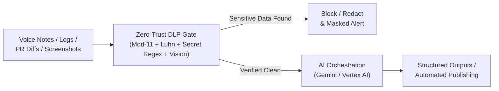

# Hi, I'm Gabriel Souza (`@gavicoding`) 👋

**IT Automation & Software Engineer | Applied AI & Data Privacy (LGPD/GDPR)**

I design and build resilient production tools across **Python, TypeScript, and C# (.NET)** — turning repetitive IT operations, distributed retail/warehouse bottlenecks, and compliance risks into automated, observable, and secure software.

---

## 🔧 What I Build

- **IT Fleet & Operations Automation:** Windows services, remote agents with mutual TLS (mTLS), unattended desktop migrations, and automated sales/sync recovery workflows.
- **Infrastructure Mapping & Observability:** End-to-end service dependency topology maps, read-only database replication monitors, trend-based alerting heuristics, and operational picking/throughput KPIs.
- **Applied AI & Zero-Trust DLP:** Multimodal AI pipelines paired with deterministic & vision-based Data Loss Prevention (LGPD/GDPR PII, tokens, and internal IP guardrails) + GitHub PR API auditing.
- **Native Windows Engineering:** MVVM desktop applications in .NET 8 + WPF and standalone PyInstaller utilities built for non-technical end users and IT support teams.

---

## 🚀 Featured Open-Source Projects

| Project | Stack | Description |
| :--- | :--- | :--- |
| **[pii-screenshot-guard](https://github.com/gavicoding/pii-screenshot-guard)** ([Docs](https://gavicoding.github.io/pii-screenshot-guard/)) | Python · CLI · GitHub API · OCR/Vision · Docker | Zero-Trust DLP scanner, redactor & GitHub PR diff auditor catching LGPD/GDPR PII (mod-11 CPF/CNPJ, Luhn cards), API secrets, and RFC 1918 internal IPs in logs, PRs, and screenshots. |
| **[queue-health-watchdog](https://github.com/gavicoding/queue-health-watchdog)** | TypeScript · Node.js · Docker | Read-only replication & job queue monitor with snapshot trend heuristics (distinguishing active `HIGH_LOAD` from `STALLED` queues), cooldown alert throttling, webhooks, and a live status dashboard. |
| **[OtimizaPC](https://github.com/gavicoding/OtimizaPC)** | C# · .NET 8 · WPF (MVVM) | Dark-mode Windows system optimizer with System Restore Points, multi-profile cleanup, content-hash duplicate finder, 90-day orphan residue detection, S.M.A.R.T. health, and instant disk space analysis. |
| **[Thunderbird-Outlook](https://github.com/gavicoding/Thunderbird-Outlook)** | Python · COM · SQLite · vCard 3.0 | Bidirectional Windows email & address-book migrator preserving folder trees, original received dates (`MSGFLAG_UNSENT` / MAPI), senders, attachments, and long file paths (`\\?\`). |

---

## 🗺️ Visual Architecture Highlights (Sanitized)

### Distributed Infrastructure Topology, Fleet Control & ERP Sync Observability

### Applied AI & Zero-Trust DLP Pipeline

---

## 🏗️ Selected Private Production Architectures (Sanitized Case Studies)

> Many of my daily production systems run in private corporate environments and remain strictly private. Below are architectural summaries of systems I engineered end-to-end:

### 1. Infrastructure & Service Dependency Topology Map
- **Challenge:** Distributed retail environments often struggle during outages because teams cannot quickly see how stores, departments, hosts, and background services depend on each other.
- **Architecture:** Built a unified **infrastructure & service topology map** linking distributed store locations, operational sectors, host nodes, and running services — enabling rapid fault correlation, dependency visualization, and root-cause isolation.

### 2. Automated Sales Retransmission & Sync Recovery
- **Challenge:** Intermittent store connectivity and validation errors caused recurring bottlenecks in sales retransmission between POS/store databases and the central ERP.
- **Architecture:** Engineered an automated detection and **sales retransmission pipeline** that identifies stalled batches, pinpoints failing records early, executes safe recovery/retransmission workflows, and dispatches proactive alerts before manual escalation.

### 3. Warehouse Picking & Operational Performance Analytics
- **Challenge:** Lack of granular operational metrics made it difficult to measure order separation (picking) throughput, queue delays, and sector efficiency.
- **Architecture:** Built performance tracking and bottleneck analytics around warehouse separation/picking stages, surfacing actionable KPIs to support faster fulfillment and data-driven operational adjustments.

### 4. Multi-Store Windows Fleet Management Agent (`100+ Endpoints`)
- **Challenge:** Standardize monitoring, diagnostics, and controlled remote actions across hundreds of distributed retail workstations, POS terminals, and store servers.
- **Architecture:** Windows service agent (`NSSM` / `LocalSystem`) communicating over persistent **WebSockets secured with mTLS** to a **FastAPI + PostgreSQL** central control plane, featuring heartbeat telemetry, remote commands, self-updates, watchdogs, and anti-tamper protections.

### 5. Read-Only ERP Replication Watchdog
- **Challenge:** Detect stuck HQ ↔ Store database replication queues early without ever writing to production ERP tables or flooding IT support with false alarms during peak hours.
- **Architecture:** **TypeScript + Prisma** polling worker capturing periodic snapshots of SQL Server replication tables (`read-only`), distinguishing `HIGH_LOAD` from `STALLED` via trend heuristics, with throttled alerting.

### 6. ITSM + CCTV Evidence Automation Pipeline
- **Challenge:** Eliminate manual ticket triage and manual camera footage retrieval across dozens of distributed store NVRs/DVRs.
- **Architecture:** **Python** orchestrator integrating ITSM ticketing APIs with heterogeneous DVR/NVR HTTP APIs & fallback automation, complete with retry queues for intermittent store connectivity and automated ticket updates.

### 7. AI Workflow Copilot with Vision DLP Gate
- **Challenge:** Turn raw voice notes, RSS feeds, and screenshots into structured technical posts safely without risking credential or internal infrastructure exposure.
- **Architecture:** Async **Python** service deployed via **Docker / Cloud Run**, integrating Gemini/Vertex AI, PostgreSQL, OAuth 2.0 publishing, and an automated Vision DLP audit layer that blocks screenshots containing leaked tokens, emails, or internal IPs.

---

## 🌎 Collaboration & Availability

- **Working Style:** Remote · Async-first · Clear technical writing in **English** and **Portuguese**
- **Focus Areas:** IT Automation, Backend/Platform Engineering (Python / TypeScript), Windows Tooling (.NET / Python), Applied AI & Privacy Engineering (LGPD/GDPR)
- **GitHub:** [@gavicoding](https://github.com/gavicoding)

---

🇧🇷 Resumo em Português (Clique para expandir)

### Gabriel Souza (`@gavicoding`) — Engenharia de Software, Automação de TI & IA Aplicada

Desenvolvo sistemas de produção e ferramentas de automação com foco em **Python, TypeScript e C# (.NET)** — resolvendo gargalos reais de operação de TI, infraestrutura distribuída, observabilidade e segurança/privacidade de dados (LGPD/GDPR).

- **Projetos Open-Source em Destaque:**
  - [`pii-screenshot-guard`](https://github.com/gavicoding/pii-screenshot-guard) ([Documentação](https://gavicoding.github.io/pii-screenshot-guard/)): Scanner, redator e auditor de PRs via API do GitHub com foco em Zero-Trust DLP (LGPD/GDPR, CPF/CNPJ com dígito verificador, cartões Luhn, chaves de API, IPs internos e OCR/Vision).
  - [`queue-health-watchdog`](https://github.com/gavicoding/queue-health-watchdog): Monitor somente leitura de filas/replicação em TypeScript com heurística de tendência (diferencia `HIGH_LOAD` de `STALLED`), throttling de alertas, webhooks e dashboard ao vivo.
  - [`OtimizaPC`](https://github.com/gavicoding/OtimizaPC): Otimizador nativo para Windows em .NET 8 + WPF (MVVM), com pontos de restauração, limpeza multi-usuário, busca de duplicados por hash e análise instantânea de disco.
  - [`Thunderbird-Outlook`](https://github.com/gavicoding/Thunderbird-Outlook): Migrador bidirecional de e-mails e contatos entre Thunderbird e Outlook Clássico preservando datas originais, remetentes e caminhos longos no Windows.

- **Experiência em Arquiteturas Corporativas (Casos Sanitizados):**
  - **Mapa de Topologia de Infraestrutura & Serviços:** mapeamento conectando lojas, setores, servidores e serviços ativos para detecção rápida de falhas e isolamento de causa raiz.
  - **Automação de Retransmissão de Vendas:** detecção proativa de gargalos de transmissão entre lojas/PDVs e ERP central com fluxos automáticos de recuperação e alertas.
  - **Analytics de Performance na Separação (Picking):** visibilidade operacional de etapas, filas e indicadores de produtividade logística.
  - **Agente de Gerenciamento de Frota Windows (`100+ máquinas`):** serviço Windows via WebSockets com mTLS, painel FastAPI + PostgreSQL e watchdogs.
  - **Monitor Somente Leitura de Replicação SQL Server:** heurística anti-falso-positivo e alertas com cooldown.
  - **Orquestrador ITSM + CFTV:** automação de coleta de evidências em DVRs/NVRs com fila de retentativas e atualização automática de chamados.
  - **Copiloto Assíncrono de Conteúdo com Vision DLP:** pipeline Docker/Cloud Run com auditoria visual automática antes da publicação.

